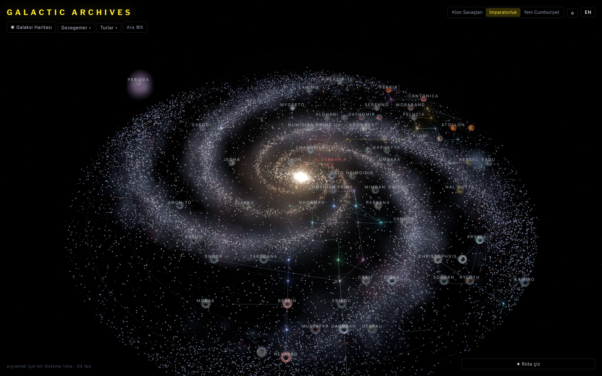
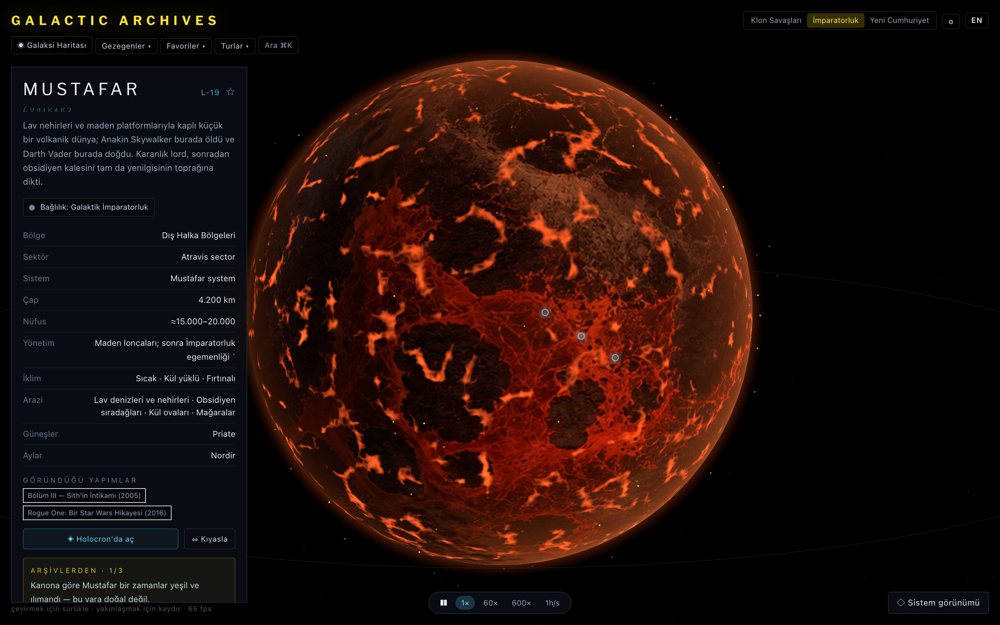
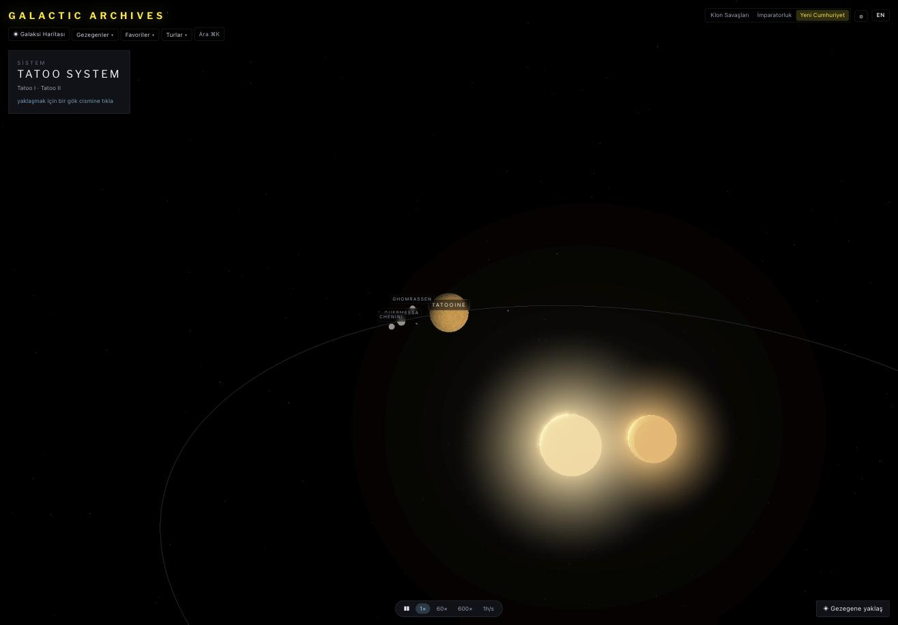
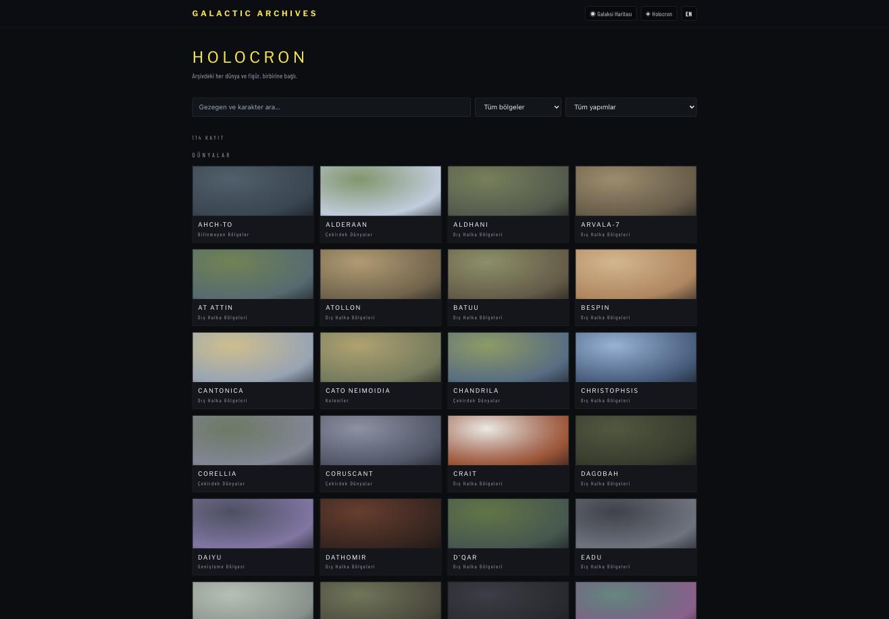
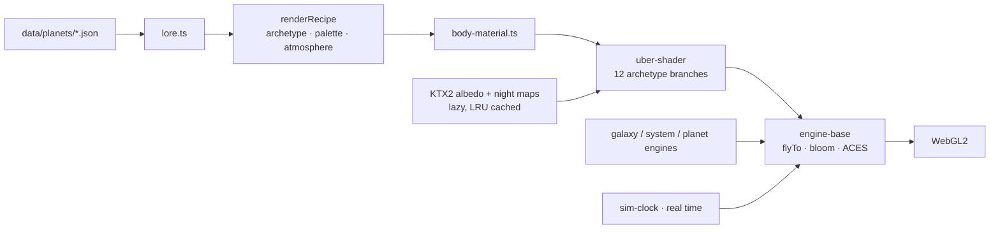

<div align="center">



<p>
  <a href="https://galactic-archives.vercel.app/galaxy"></a>
  
  
  
</p>

<p><em>A fan-made 3D atlas: fly from the galaxy disc to a star system and down to a planet's surface in one camera move.<br>
Every world is drawn live by a procedural GLSL shader, and every line of lore is sourced.</em></p>

<a href="https://galactic-archives.vercel.app/galaxy"></a>

</div>


## What it is

Galactic Archives turns the galaxy into a navigable atlas. The planets are lit by their suns, with atmosphere scattering, cloud and ring shadows, city lights on the night side and a terminator that moves with the real clock. On top of that sit three layers:

- **Holocron**: a fully bilingual, cross-linked wiki of 88 bodies, 33 figures and 83 sourced codex entries.
- **Eras**: Clone Wars, Empire and New Republic (plus the Old Republic with Legends on). Switch era and the galaxy changes: Alderaan breaks, the Death Star enters orbit, Ilum becomes Starkiller Base.
- **Hyperspace network**: 23 lanes drawn on canon grid squares, each one clickable, shareable and flyable.

> **No backend, no account, no API calls.** All data is static JSON and all visuals are raw three.js. The same codebase ships to Vercel and, through Tauri v2, as a macOS `.dmg`.


## The armoury

| | |
|---|---|
| **Three-level hierarchy** | Galaxy disc → star system → planet surface, joined by camera flights instead of cuts. |
| **Living planets** | 12 surface archetypes, KTX2 albedo maps for 88 worlds, 12 night maps and relief derived from the textures. |
| **Light and shadow** | Sun-aware scattering, a sunset band, cloud / ring / moon eclipse shadows, lens flare and ice glint. |
| **Hyperspace lanes** | 23 lanes and 308 stops; share one with `?lane=<id>`, fly six of them end to end. |
| **Route planner** | Pick two worlds and the course is plotted along the lanes, with the distance in parsecs. |
| **HoloNet ticker** | Sourced headlines from the selected era; click one to fly to its world. |
| **Bounty board · Sabacc** | Canon contracts tied to their worlds, and a three-round Corellian Spike game against a dealer droid. |
| **Ambient sound** | A soundscape synthesised per planet archetype. Optional, and there are no audio files. |
| **Compare** | Two to four live globes side by side at true diameter ratio, shareable by URL. |
| **Command palette** | <kbd>⌘</kbd> <kbd>K</kbd> fuzzy search that understands Turkish characters. |

<table>
  <tr>
    <td width="33%"></td>
    <td width="33%"></td>
    <td width="33%"></td>
  </tr>
  <tr>
    <td align="center"><code>planet</code> · lava archetype</td>
    <td align="center"><code>system</code> · twin suns</td>
    <td align="center"><code>holocron</code> · sourced wiki</td>
  </tr>
</table>


## The planet foundry



**By the numbers:** 88 bodies · 33 figures · 172 points of interest · 23 lanes · 308 stops · 15 battles · 12 archetypes · 4 eras.


## Türkçe özet

**Galactic Archives**, Star Wars galaksisini gezilebilir bir 3B atlasa çeviren bir hayran projesi. Galaksi diskinden yıldız sistemine, oradan gezegen yüzeyine kesintisiz kamera uçuşuyla iniliyor. Her dünya gerçek zamanlı GLSL shader'larla çiziliyor. İçinde iki dilli Holocron wiki'si, döneme göre değişen galaksi, 23 hiperuzay hattı, rota planlayıcı, sabacc ve ödül panosu var. Backend yok; tüm veri statik JSON. Web'de Vercel'de, masaüstünde Tauri ile macOS uygulaması olarak çalışıyor.


## Development

Requires Node.js `>= 22` and a WebGL2 browser. Dependencies live in `app/`, not the repo root.

```sh
cd app
npm install
npm run dev         # http://localhost:5173
npm test            # vitest
npm run e2e         # Playwright
npm run verify      # everything, the pre-commit gate
npm run desktop     # Tauri v2 macOS build (Rust toolchain + Xcode CLT)
```

No environment variables, no database, no keys: all data is in the repo.


## License

Code is **MIT**. Lore text is sourced from **Wookieepedia (CC BY-SA)** and shared under the same licence. This is an unofficial fan project, **not affiliated with Lucasfilm or Disney**. Star Wars and all related names belong to Lucasfilm Ltd. No copyrighted images, logos or audio are distributed.

<div align="center">
<br>
<a href="https://github.com/kutluhangil"></a>
<sub>Made for a galaxy far, far away.</sub>
</div>
