<div align="center">

<br />

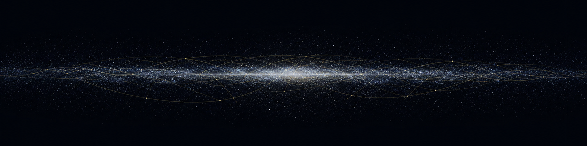

<br />


<br /><br />

```
 ██████╗  █████╗ ██╗      █████╗  ██████╗████████╗██╗ ██████╗
██╔════╝ ██╔══██╗██║     ██╔══██╗██╔════╝╚══██╔══╝██║██╔════╝
██║  ███╗███████║██║     ███████║██║        ██║   ██║██║
██║   ██║██╔══██║██║     ██╔══██║██║        ██║   ██║██║
╚██████╔╝██║  ██║███████╗██║  ██║╚██████╗   ██║   ██║╚██████╗
 ╚═════╝ ╚═╝  ╚═╝╚══════╝╚═╝  ╚═╝ ╚═════╝   ╚═╝   ╚═╝ ╚═════╝
 █████╗ ██████╗  ██████╗██╗  ██╗██╗██╗   ██╗███████╗███████╗
██╔══██╗██╔══██╗██╔════╝██║  ██║██║██║   ██║██╔════╝██╔════╝
███████║██████╔╝██║     ███████║██║██║   ██║█████╗  ███████╗
██╔══██║██╔══██╗██║     ██╔══██║██║╚██╗ ██╔╝██╔══╝  ╚════██║
██║  ██║██║  ██║╚██████╗██║  ██║██║ ╚████╔╝ ███████╗███████║
╚═╝  ╚═╝╚═╝  ╚═╝ ╚═════╝╚═╝  ╚═╝╚═╝  ╚═══╝  ╚══════╝╚══════╝
```

### **Çok uzak bir galaksinin atlası** — 88 gök cismi, 23 hiperuzay hattı, sıfır backend, tarayıcıda gerçek zamanlı.

*"Uzun zaman önce, çok çok uzak bir galakside…"*

[**Galaksiye gir →**](https://galactic-archives.vercel.app/galaxy) · [Holocron](https://galactic-archives.vercel.app/holocron) · [Kıyasla](https://galactic-archives.vercel.app/compare) · [Hata bildir](https://github.com/kutluhangil/GalacticArchives/issues)

</div>

---

## ✦ Galactic Archives nedir?

**Galactic Archives**, Star Wars galaksisini gezilebilir bir **3D atlasa** çeviren bir hayran
projesidir. Galaksi diskinden bir yıldız sistemine, oradan gezegenin yüzeyine kesme olmadan,
kamera uçuşuyla inersin. Her dünya **prosedürel GLSL shader'larla** gerçek zamanlı çizilir —
repoda tek bir telifli doku yok, gündüz/gece terminatörü gerçek saatle ilerler.

Üstünde iki katman daha var:

- **Holocron** — 88 gök cismi ve 33 figürün çapraz bağlı, tamamen iki dilli wiki'si.
- **Zaman ekseni** — Klon Savaşları / İmparatorluk / Yeni Cumhuriyet (+ yalnız Legends açıkken
  Eski Cumhuriyet). Dönemi değiştirdiğinde galaksi değişir: Alderaan kırılır, Ölüm Yıldızı
  belirir, bağlılık renkleri döner.

Ve son fazda gelen katman: **hiperuzay ağı** — 23 çizili hat, kanonun verdiği grid kareleriyle,
tıklanabilir ve uçulabilir.

> **Backend yok, hesap yok, API çağrısı yok.** Tüm veri statik JSON, tüm görsel ham three.js ile
> çizilir. Aynı kod tabanı hem Vercel'de web olarak hem de Tauri v2 ile 12 MB'lık macOS `.dmg`
> olarak paketlenir.

---

## ⚡ Öne çıkan özellikler

| Özellik | Açıklama |
|---|---|
| 🌌 **Üç kademeli hiyerarşi** | Galaksi diski → yıldız sistemi → gezegen yüzeyi. Aralarda kesme yok, kamera uçuşu var. |
| 🎨 **Prosedürel gezegenler** | 12 arketip (çöl, buz, lav, ekumenopolis, gaz devi, bataklık…), tamamı GLSL. Doku dosyası sıfır. |
| 🛰️ **Hiperuzay ağı** | 23 hat, 308 durak. Hattı tıkla, panelini aç, `?lane=<id>` ile paylaş; 6 hat uçtan uca uçulabilir. |
| 🧭 **Rota planlayıcı** | İki dünya seç, kurs hatlar üzerinden çizilsin, mesafe parsek olarak hesaplansın. |
| 🕰️ **Dönem sistemi** | 3 kanon dönem + Legends açıkken Eski Cumhuriyet. Bağlılık, mevcudiyet ve gövde durumu döneme göre değişir. |
| 📜 **Holocron wiki** | 121 kayıt — dünyalar ve figürler çapraz bağlı, bölge/medya filtreli. |
| 📍 **172 ilgi noktası** | 86 gövdede işaretli yer; **hepsi** Wookieepedia makalesiyle kaynaklı, süreklilik uyumu derlemede doğrulanıyor. |
| ⚖️ **Kıyaslama** | İki canlı küre yan yana + gerçek çap oranı şeridi + istatistik tablosu, URL ile paylaşılabilir. |
| 🎬 **Rehberli turlar** | 6 elle yazılmış tur + her uçulabilir hattın kendi dünyalarının açıklamasından **üretilen** turu. |
| ⌘ **Komut paleti** | ⌘K ile Türkçe-duyarlı bulanık arama; gezegen, karakter, bölge filtresi tek kutuda. |
| ♿ **Klavye + ekran okuyucu** | Haritadaki dünyalar ve hatlar `sr-only` listelerle gezilebilir; `prefers-reduced-motion` gerçek bir dal. |
| 🌍 **TR / EN** | Tüm arayüz ve tüm lore içeriği iki dilli — tip düzeyinde zorunlu, tek dilli anahtar derlemeyi keser. |
| 📜 **Arşiv bölümleri** | Zaman Çizelgesi, Güç Kasası, İzleme Rehberi ve Hangar — dördü de kendi statik sayfasını ve yapılandırılmış verisini üretiyor. |
| 🛠 **Araç panelleri** | Hiperuzay sıçrama süresi, ışın kılıcı formları, telsiz kayıtları, Aurebesh çevirici, holo-kimlik — hepsi tembel yüklenen birer dialog. |
| 🖥️ **macOS uygulaması** | Tauri v2 · 12 MB `.dmg` · yüksek kalite katmanı varsayılan. |

<div align="center">
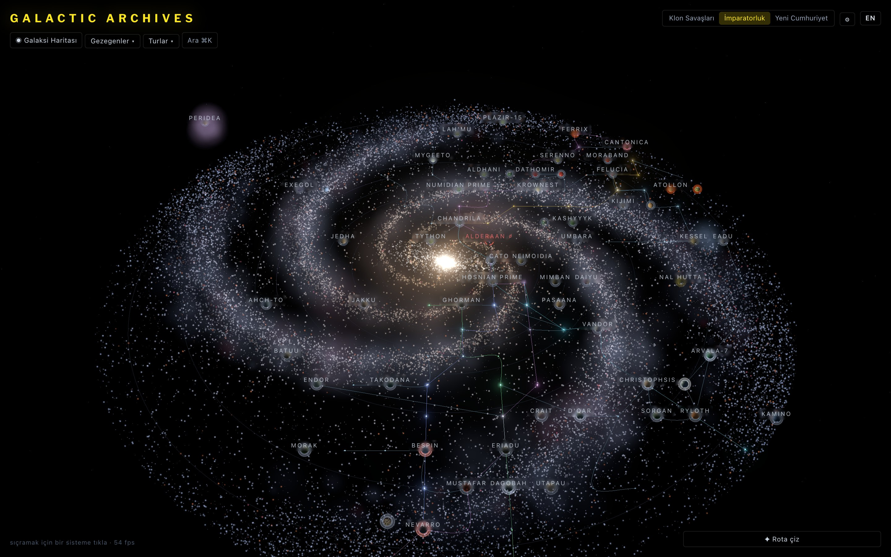
<sub><i>Galaksi haritası — logaritmik sarmal kollar, nebula pusu, çubuklu çekirdek, 23 hiperuzay hattı.</i></sub>
<br /><br />
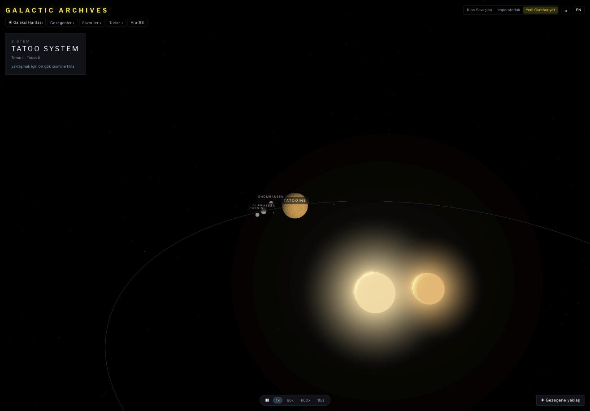
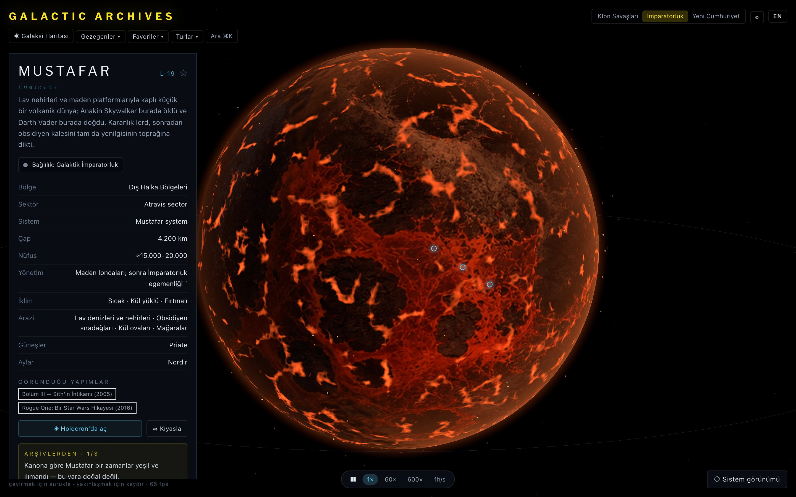
<br />
<sub><i>Hiyerarşinin diğer iki kademesi — sol: Tatoo sistemi, sağ: Mustafar yüzeyi. Kesme yok;
kamera aradaki yolu uçuyor.</i></sub>
</div>

---

## 🗂️ Veri nereden geliyor?

Tüm lore verisi **Wookieepedia** ve **StarWars.com Databank**'tan çekilip doğrulandı.
`scripts/validate-lore.mjs` kaynaksız alanı, var olmayan makaleyi ve süreklilik uyumsuzluğunu
derlemede reddeder — dijest repoda, yani CI aynı kontrolü tekrar üretebilir.

| Kaynak | Ne için | Yöntem | Durum |
|---|---|---|:-:|
| **Wookieepedia** | Gezegen istatistikleri, bölge, sektör, nüfus, yönetim, hat durakları | `starwars.fandom.com/api.php` digest → `fetch-lore.mjs` / `fetch-routes.mjs` | ✅ |
| **Wookieepedia** | İlgi noktaları ve atıfları | `fetch-poi.mjs` + `slim-poi.mjs` anlık görüntüsü | ✅ |
| **StarWars.com Databank** | Karakter biyografileri, çapraz kontrol | Manuel çapraz doğrulama | ✅ |
| **Prosedürel shader** | Tüm gezegen yüzeyleri, galaksi diski, yıldız alanları | 12 arketipli uber-shader + FBM gürültü | 🎨 |
| **Holo-büst yer tutucusu** | Karakter portreleri | Prosedürel siluet + tarama çizgisi | 🟡 |

**Son doğrulama:** `bodies=88 · points of interest=172 across 86/88 bodies, 172 cited · ERRORS: 0 · WARNINGS: 2`
(uyarıların hepsi "kanon bu durak için grid karesi vermiyor" gibi bilinçli boşluklar).

---

## 📊 Kapsam

> **88 gök cismi** · 33 figür · 121 Holocron kaydı · 172 yer · 23 hiperuzay hattı · 308 durak · 12 yüzey arketipi · 4 dönem

**Bölgeye göre** — merkezden dışa (81 gezegen dosyası)

| Derin Çekirdek | Çekirdek | Koloniler | İç Halka | Genişleme | Orta Halka | Dış Halka | Vahşi Uzay | Bilinmeyen | Uzak Galaksi |
|:--:|:--:|:--:|:--:|:--:|:--:|:--:|:--:|:--:|:--:|
| 1 | 6 | 2 | 3 | 4 | 8 | **49** | 2 | 5 | 1 |

**Yüzey arketipine göre** — 12 shader dalı

| Arketip | Dünya | Arketip | Dünya |
|---|:--:|---|:--:|
| 🌿 Verdant | **26** | 🪨 Barren | **5** |
| 🏜️ Desert | **12** | ⛈️ Dark-storm | **4** |
| ❄️ Ice | **7** | 🌫️ Swamp-fog | **4** |
| 🌊 Ocean-storm | **6** | 🪐 Gas-giant | **3** |
| 🔴 Crystal-red | **6** | 🌋 Lava | **2** |
| 🏙️ Ecumenopolis | **5** | 🛰️ Station | **1** |

**Süreklilik:** 74 kanon + 7 Legends dünyası (ayarlardan açılır; kendi dönemini de açar).

<div align="center">
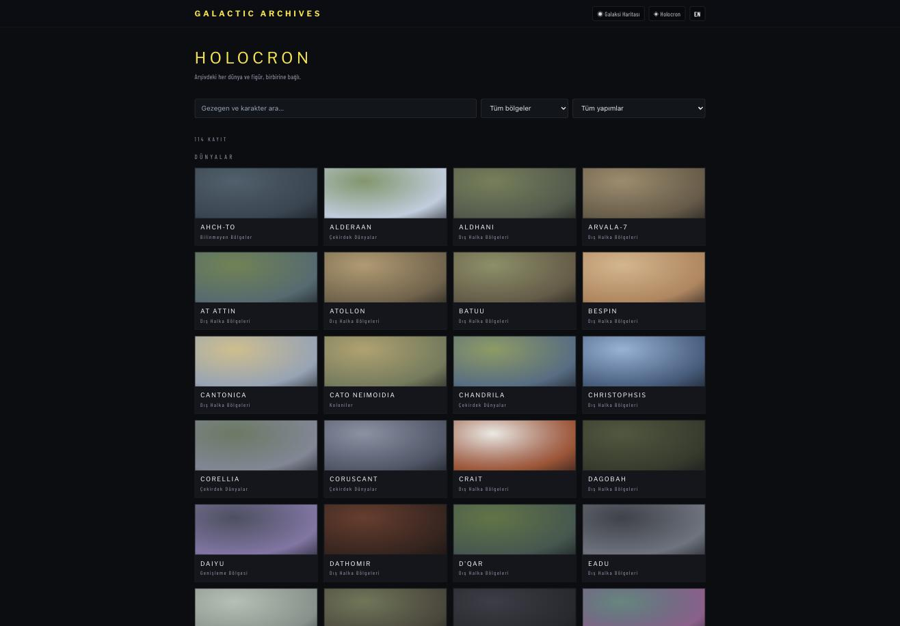
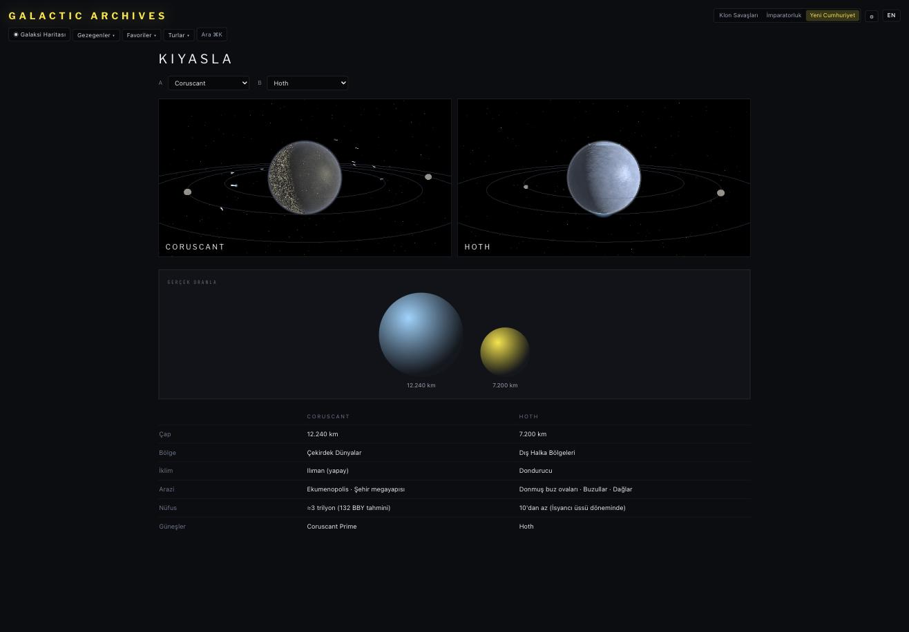
<br />
<sub><i>Sol: Holocron, filtreli katalog. Sağ: Kıyaslama, iki canlı küre + gerçek çap oranı.</i></sub>
</div>

---

## 📜 Arşiv bölümleri

Haritanın dışındaki dört rota kendi sayfası: her kayıt geçtiği dünyaya bağlı, her kayıt
yazıldığı Wookieepedia maddesini gösteriyor.

<div align="center">
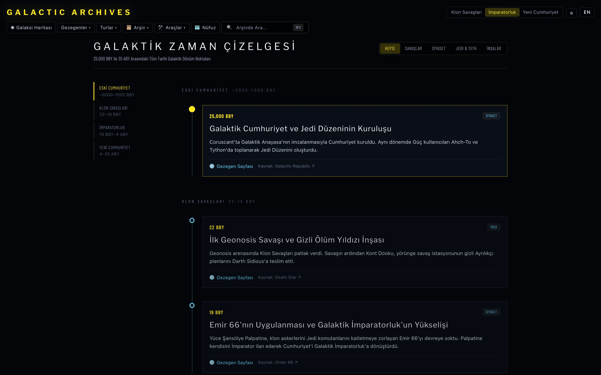
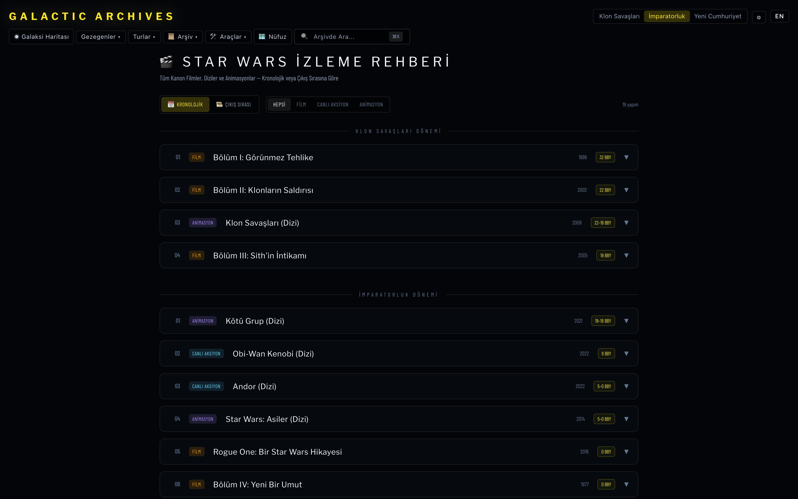
<br />
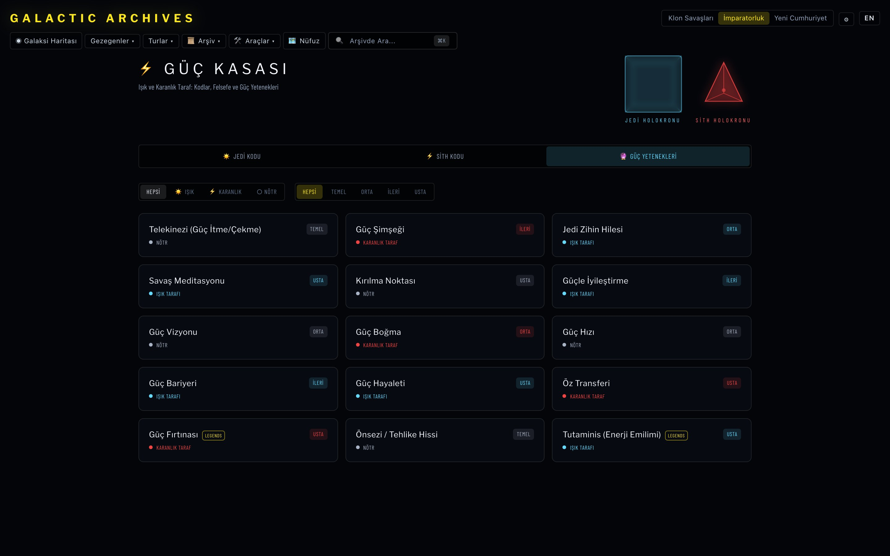
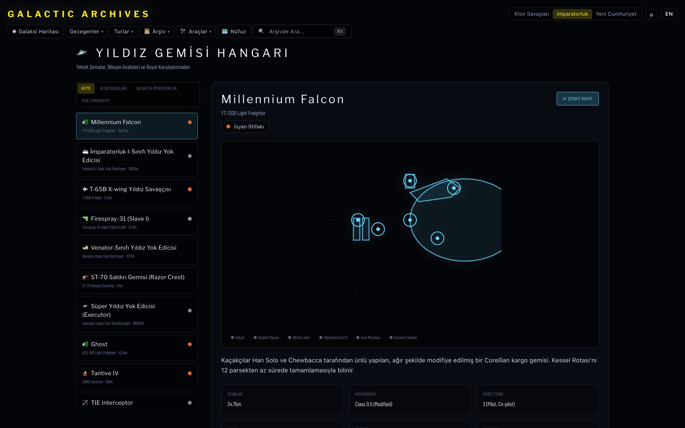
<br />
<sub><i>Üst sol: 25.000 BBY'den 35 ABY'ye zaman çizelgesi. Üst sağ: kronolojik/çıkış sırası izleme
rehberi. Alt sol: Güç Kasası'nın 15 yeteneği, kademe ve taraf filtreli. Alt sağ: hangar, gemi
şeması açık.</i></sub>
</div>

<div align="center">
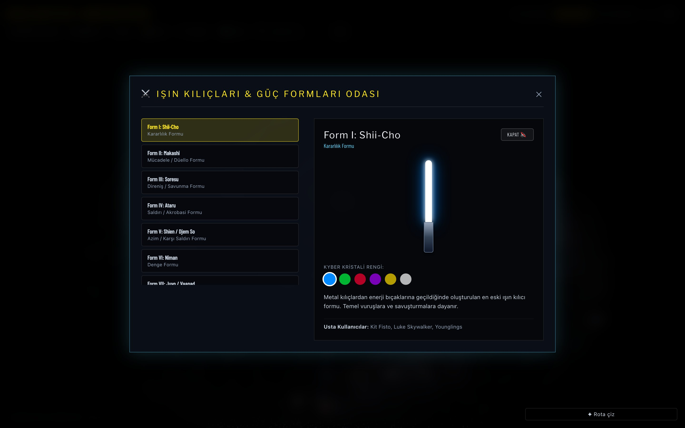
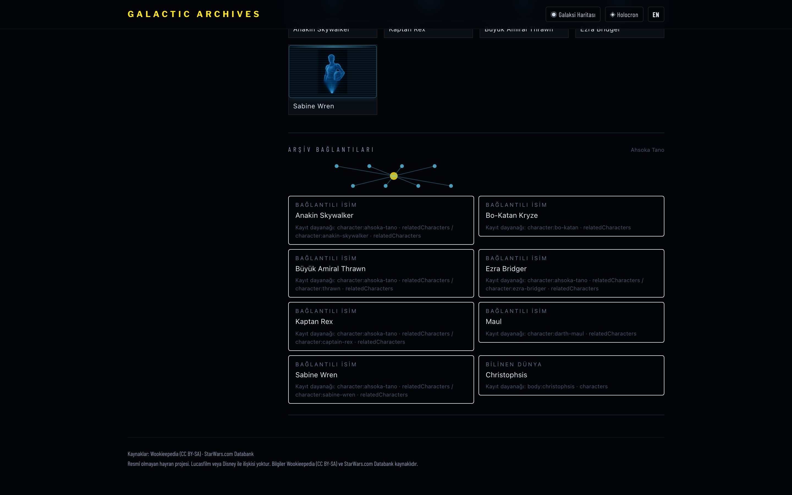
<br />
<sub><i>Sol: araç panelleri — ışın kılıcı formları, haritanın üstünde bir dialog olarak. Sağ: arşiv
bağlantıları — her bağlantının hangi kayıt alanından çıktığı yazılı.</i></sub>
</div>

---

## 🛠️ Teknoloji

```
Çatı         →  Vite 8 · React 19 · TypeScript 5.9 · React Router 8 (data router)
Render       →  Ham three.js r186 · özel GLSL · WebGL2 (React Three Fiber kullanılmadı)
Stil         →  Tailwind CSS 4 (tema `src/index.css` içinde; shadcn/Radix katmanı söküldü)
Durum        →  Zustand · localStorage (dil, dönem, kalite, favoriler, Legends, onboarding)
Veri         →  Statik JSON · backend yok · API çağrısı yok · çalışma zamanı fetch'i yok
Test         →  Vitest + Testing Library (312 test) · Playwright (39 e2e)
CI           →  GitHub Actions: tsc -b · eslint · validate-lore · build
Güvenlik     →  vercel.json sıkı CSP + HSTS/Referrer/Permissions · Tauri csp dolu · Dependabot
Masaüstü     →  Tauri v2 (Rust + WKWebView) → aarch64 .dmg
Dağıtım      →  Vercel · SPA rewrite + derleme sonrası statik meta/OG/sitemap üretimi
                Vercel projesinde Root Directory = `app` olmalı; kökte package.json yok
```

**Neden ham three.js?** Motor shader ağırlıklı ve tek karede 80+ küre ile üç nokta bulutu
çiziyor; React Three Fiber'ın reconciler'ı bu iş için gereksiz bir katman olurdu.

---

## 🔄 Nasıl çalışıyor (render akışı)

```
  data/planets/*.json ──▶ lore.ts ──▶ renderRecipe { archetype, palette, relief, textures }
                                            │
                                            ▼
                       body-material.ts ──▶ uber-shader (12 arketip dalı)
                                            │  + noise-glsl (FBM)
                                            │  + relief (yükseklik gradyanı → normal)
                                            │  + planet-textures (varsa albedo/night karışır)
                                            ▼
  galaxy-engine ──┐
  system-engine ──┼──▶ engine-base (sahne · kamera · flyTo · bloom) ──▶ WebGL2
  planet-engine ──┘
                                            ▲
  sim-clock.ts (gerçek saat) ────────────────┘   terminatör ve yörüngeler canlı ilerler
```

- **Galaksi** — 3 nokta bulutu (kol yıldızları, kollar arası alan, nebula pusu) + arketip küreleri
  (`uRelief=0`, kaba küre) + hiperuzay hatları ve her hattın görünmez tüp hedefi
- **Sistem** — güneş(ler), yörünge çizgileri, gezegen + ayları, hızlandırılabilir sim zamanı
- **Gezegen** — tam kabartmalı küre, atmosfer rim ışığı, bulut katmanı, bloom, ilgi noktaları
- **Geçiş** — `useFlyTo` kamerayı hedefe süzer, varan görünüm aynı kadrajdan devralır;
  Holocron tarafında `startViewTransition` ile kart↔portre morph'u

---

## 🛰️ Hiperuzay hatları

Hat seçimi URL'de yaşar (`/galaxy?lane=<id>`) — paylaşılabilir ve geri tuşuyla gezilir.
Bir çizgiyi ışın izleme ile tutturmak her yakınlaşmada güvenilmez olduğundan, her hattın
çizdiği eğri boyunca **görünmez bir tüp** var; hattın üstünde duran bir dünya tıklamayı
her zaman kazanır.

| Hat | Arşivdeki durak / toplam |
|---|:-:|
| Corellian Run | 4 / 25 |
| Triellus Trade Route | 3 / 39 |
| Perlemian Trade Route | 2 / 24 |
| Hydian Way | 2 / 47 |
| Rimma Trade Route | 2 / 17 |
| Corellian Trade Spine | 2 / 50 |
| kalan 17 hat | 0 veya 1 |

Uçulabilir hat sayısı **6/23** — ve panel bunu gizlemiyor, "bu hattın burada kaydı olan durağı
yeterli değil" diyor. Hat turu her durağın anlatısını dünyanın **kendi açıklamasından** üretir;
atlanan durakları sayar ve söyler. Kalan 17 hattı açmanın yolu uydurmak değil, kavşak
dünyalarını aynı dürüstlük modeliyle arşive eklemek — yol haritasında ilk sırada.

---

## 📐 Proje yapısı

```
GalacticArchives/
├── app/
│   ├── src/
│   │   ├── lib/engine/       # engine-base · planet · system · galaxy · body-material
│   │   │                     # planet-shaders · noise-glsl · effects · planet-textures
│   │   ├── lib/              # lore · routes · lane-tour · collections · tours · galaxy-grid
│   │   │                     # quality · sim-clock · sources · ui-strings (t / tf)
│   │   ├── pages/            # Landing · GalaxyView · SystemView · PlanetView · Compare
│   │   │                     # Holocron · HolocronPlanet · HolocronCharacter
│   │   ├── components/       # TransitionVeil · useFlyTo · TourPlayer · HoloPortrait
│   │   │                     # CommandPalette · ErrorBoundary · OnboardingHint · hud/*
│   │   ├── state/            # app.ts (zustand)
│   │   └── data/             # planets/*.json (81 + 5 detaylı ay) · characters.json (33)
│   │                         # stations.json (2) · routes.json (23) · tours.json (6) · sources.json
│   ├── scripts/              # fetch-lore · fetch-poi · fetch-routes · validate-lore
│   │                         # process-textures · build-static-meta · check-bundle-budget
│   ├── test/                 # unit (21) · component (14) · integrity (1) · 283 test
│   ├── e2e/                  # Playwright · 31 test
│   ├── src-tauri/            # Tauri v2 masaüstü kabuğu
│   └── vercel.json           # SPA rewrite + güvenlik başlıkları
├── docs/                             # projenin tüm belgeleri (index: docs/README.md)
│   ├── kalan-isler.md                # ne bitti, ne sende, ne bende
│   ├── roadmap.md                    # öncelikli iş listesi
│   ├── gorsel-uretim-promptlari.md   # 224 görsel için üretim promptu
│   ├── proje-denetim-raporu-2026-08-01.md
│   ├── superpowers/                  # faz spec'leri ve uygulama planları
│   ├── brand/ · screenshots/
└── CHANGELOG.md · LICENSE
```

---

## 🚀 Kurulum

### Gereksinimler
- Node.js `>= 22` (CI 22'de koşuyor)
- WebGL2 destekleyen tarayıcı
- (opsiyonel) `.dmg` derlemek için Rust toolchain + Xcode CLT

```bash
# Klonla
git clone https://github.com/kutluhangil/GalacticArchives.git
cd GalacticArchives/app

# Bağımlılıklar  (DİKKAT: kökte değil, app/ içinde)
npm install

# Uçtan uca test koşacaksan tarayıcı ikilisi (bir kez)
npx playwright install chromium

# Geliştirme
npm run dev        # http://localhost:5173
```

> **Ortam değişkeni yok, veritabanı yok, anahtar yok.** `npm install && npm run dev` yeterli —
> tüm veri repoda.

### Komut kartı

| Komut | Ne yapar |
|---|---|
| `npm run dev` | Geliştirme sunucusu |
| `npm run build` | `tsc -b` + vite build + statik meta/OG/sitemap üretimi |
| `npm run lint` | ESLint |
| `npm run validate` | Lore doğrulama (kaynak, koordinat, çap, süreklilik) |
| `npm run validate:assets` | 224 görsel hedefte ID, boyut, format, dikiş ve manifest doğrulaması |
| `npm test` | Vitest — 312 test |
| `npm run e2e` | Playwright — 31 test (ilk kez: `npx playwright install chromium`) |
| `npm run budget` | Paket bütçesi kontrolü |
| `npm run verify` | Hepsi sırayla — commit öncesi kapı |
| `npm run textures` | `raw/planets/*.png` → 4K/2K/1K WebP/KTX2 + manifest |
| `npm run desktop` | Tauri derlemesi → `.dmg` |

### Kendi dokularını koymak

`app/raw/planets/<id>-albedo.png` (2:1 equirectangular, 4096×2048) bırakıp `npm run textures`
çalıştırırsan motor üretilen albedo haritasını prosedürel yüzeyin üstüne karıştırır. Şehir
dünyaları için `<id>-night.png` de okunur. **88 gövdenin hepsi ve 33 portre için hazır
promptlar:** [`docs/gorsel-uretim-promptlari.md`](docs/gorsel-uretim-promptlari.md).

---

## 📈 Ölçümler

| Ölçüm | Değer |
|---|:-:|
| İlk boya toplamı (bütçe 390 000) | **367 893 bayt** |
| three vendor chunk | **638 275 bayt** |
| Birim test | **312** (40 dosya) |
| E2E test | **39** |
| `validate-lore` | **0 hata**, 2 bilinçli uyarı |
| Çalışma zamanı bağımlılığı | **9** (44 ölü paket söküldü) |
| Galaksi haritası | **77 fps** (74 dünyalık ölçümde) |
| Gezegen görünümü | **~115 fps** |
| 50 gezegen geçişinde heap büyümesi | **%6,5** (bütçe <%10) |
| `.dmg` boyutu | **12 MB** |

<sub>Ölçüm ortamı: Apple M4, Chrome, 1360×904. FPS rakamları hiperuzay ağı eklenmeden önce alındı; yeniden ölçülecek.</sub>

---

## 🗺️ Yol haritası

| Durum | Madde |
|:-:|---|
| ✅ | Üç kademeli motor (galaksi · sistem · gezegen), 12 arketipli prosedürel uber-shader |
| ✅ | 88 gök cismi, 33 figür, 174 ilgi noktası — hepsi kaynaklı ve doğrulanıyor |
| ✅ | Dönem sistemi + Legends katmanı (7 dünya, kendi dönemiyle) |
| ✅ | Holocron wiki, kıyaslama, rehberli turlar, ⌘K komut paleti |
| ✅ | Hiperuzay ağı: 23 hat, seçilebilir, paylaşılabilir, 6'sı uçulabilir |
| ✅ | Test kalkanı (283 birim + 31 e2e), GitHub Actions CI, ErrorBoundary, CSP, LICENSE |
| ✅ | Vercel dağıtımı + Tauri v2 macOS `.dmg` |
| ○ | **Hat veri borcu** — 17 hattı açacak ~20 kavşak dünyası |
| ○ | Gemini gezegen dokuları + KTX2 (promptlar hazır, görseller bekliyor) |
| ○ | Holocron kart görselleri ve gerçek holo-büst portreleri |
| ○ | Harita göstergesi (legend): hat renkleri, düğüm renkleri, yıkım işareti |
| ○ | Veri için mono yazı tipi rolü + tek `focus-visible` kuralı + "içeriğe atla" bağlantısı |
| ○ | Kıyaslamayı ikiden fazlaya çıkarmak · karakter↔gezegen çapraz grafiği |
| ○ | `.dmg` imzalama + notarization (Apple Developer hesabı gerekiyor) |
| ⚠ | Bilinen kırık: `e2e/atlas.spec.ts` "keyboard lane list" testi hat panelini bulamıyor |

<sub>✅ Tamam &nbsp;·&nbsp; ○ Planlı &nbsp;·&nbsp; ⚠ Açık hata</sub>

---

## ✅ "Gerçek mi?" — özet

| Şey | Durum |
|---|:-:|
| Lore verisi (istatistik, bölge, biyografi, ilgi noktaları) | ✅ Wookieepedia + Databank, derlemede doğrulanıyor |
| Hiperuzay hatları ve durak koordinatları | ✅ Kanon grid kareleri; verilmeyen durak çizilmiyor |
| Gezegen yüzeyleri, galaksi diski, yıldız alanları | 🎨 Prosedürel — telifli doku yok |
| Dönem değişimleri (Alderaan, Ölüm Yıldızı) | ✅ Kanonla uyumlu |
| Terminatör ve yörünge hareketi | ✅ Gerçek saatle canlı |
| Karakter portreleri | 🟡 Geçici holo-siluet |
| Holocron kart görselleri | 🟡 Palet degradesi — bilgi taşımıyor |
| `.dmg` imzası | 🟡 İmzasız — ilk açılışta sağ tık → Aç |

---

<div align="center">
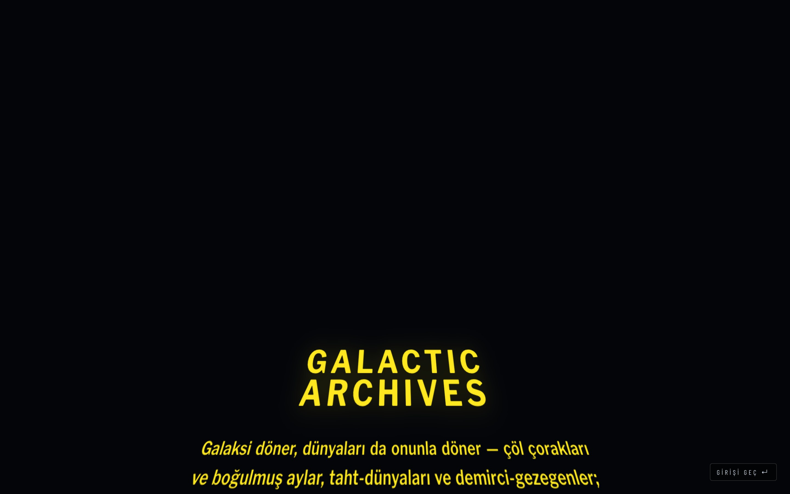
</div>

---

## 🤝 Katkı

Katkı memnuniyetle — issue aç ya da PR gönder.

1. Depoyu fork'la
2. Dal aç (`git checkout -b feature/lane-legend`)
3. `cd app && npm run verify` — tsc, lint, validate, test, build, budget, e2e hepsi geçmeli
4. PR aç

> **Veri değişikliği** yapıyorsan `npm run validate` çıktısını PR'a ekle. Kaynaksız alan,
> var olmayan makale ve süreklilik uyumsuzluğu bilinçli olarak derlemeyi keser.

---

## 📄 Lisans ve telif

Kod **MIT**; lore metinleri **Wookieepedia (CC BY-SA)** kaynaklıdır ve aynı lisansla paylaşılır.
Ayrıntı: [`LICENSE`](LICENSE).

Resmî olmayan bir hayran projesidir. **Lucasfilm veya Disney ile ilişkisi yoktur.** Star Wars ve
tüm ilgili isimler Lucasfilm Ltd.'ye aittir. Repodaki tüm görseller prosedürel olarak üretilmiştir;
telifli hiçbir varlık dağıtılmaz.

---

<div align="center">

<br />

Çok uzak bir galaksi için ❤️ ile yapıldı · **[kutluhangil](https://github.com/kutluhangil)**

<br />

*Faydalı bulduysan bir ⭐ bırak.*

<br />

</div>
