<div align="center">



<br /><br />


<br /><br />

### [**⟶ GALAKSİYE SIÇRA**](https://galactic-archives.vercel.app/galaxy)

[Holocron](https://galactic-archives.vercel.app/holocron) · [Kıyasla](https://galactic-archives.vercel.app/compare) · [Zaman Çizelgesi](https://galactic-archives.vercel.app/timeline) · [Hangar](https://galactic-archives.vercel.app/hangar) · [Hata bildir](https://github.com/kutluhangil/GalacticArchives/issues)

</div>

<br />



<details>
<summary><sub>Açılış yazısını metin olarak oku</sub></summary>

> *Uzun zaman önce, çok çok uzak bir galakside…*
>
> **BÖLÜM IV — BİR ARŞİV UYANIYOR**
>
> Galaksi bölünmüş durumda. Seksen sekiz dünya, yirmi üç hiperuzay hattı ve dört dönem boyunca
> savaşlar, imparatorluklar ve kahramanlar dağınık kayıtlarda kayboldu.
>
> Tek bir sunucuya, tek bir hesaba ihtiyaç duymayan bir atlas, her gezegeni ışık ve gölgeyle
> yeniden çizmek için yola çıktı: her satırı Wookieepedia'dan kaynaklı, her yüzeyi gerçek zamanlı
> bir shader…
>
> Şimdi Holocron açık. Rota çizilmeyi bekliyor ve sıçrama koordinatları hazır.

</details>



## ◈ HoloNet bülteni — bu arşiv nedir?

**Galactic Archives**, Star Wars galaksisini gezilebilir bir **3B atlasa** çeviren bir hayran
projesi. Galaksi diskinden bir yıldız sistemine, oradan gezegenin yüzeyine kesme olmadan,
kamera uçuşuyla inersin. Her dünya gerçek zamanlı bir GLSL shader'la çizilir: güneşe göre
aydınlanan atmosfer, bulut ve halka gölgeleri, gece tarafında şehir ışıkları, gerçek saatle
ilerleyen gündüz/gece çizgisi.

Üstünde üç katman daha var:

- **Holocron**: 88 gök cismi, 33 figür ve 83 kaynaklı kodeks kaydından oluşan, tamamen iki dilli,
  çapraz bağlı bir wiki.
- **Dönemler**: Klon Savaşları / İmparatorluk / Yeni Cumhuriyet (+ Legends açıkken Eski
  Cumhuriyet). Dönemi değiştirdiğinde galaksi değişir: Alderaan kırılır, Ölüm Yıldızı yörüngeye
  girer, Ilum Starkiller Üssü olur, bağlılık renkleri döner.
- **Hiperuzay ağı**: kanonun verdiği grid kareleriyle çizilmiş 23 hat. Tıklanabilir, paylaşılabilir,
  uçulabilir.

> **Backend yok, hesap yok, API çağrısı yok.** Tüm veri statik JSON, tüm görsel ham three.js ile
> çizilir. Aynı kod tabanı hem Vercel'de web olarak hem de Tauri v2 ile macOS `.dmg` olarak
> paketlenir.


## ⚔️ Cephanelik — öne çıkanlar

| | Özellik | Ne yapar |
|:-:|---|---|
| 🌌 | **Üç kademeli hiyerarşi** | Galaksi diski → yıldız sistemi → gezegen yüzeyi. Aralarda kesme yok, kamera uçuşu var. |
| 🪐 | **Canlı gezegenler** | 12 yüzey arketipi; 88 dünyanın KTX2 albedo haritası, 12 gece haritası, dokudan türetilen kabartma. |
| 🌅 | **Işık ve gölge** | Güneşe duyarlı atmosfer saçılımı, gün batımı bandı, bulut / halka / ay tutulması gölgeleri, lens parlaması, buz pırıltısı. |
| 🛰️ | **Hiperuzay ağı** | 23 hat, 308 durak. Hattı tıkla, panelini aç, `?lane=<id>` ile paylaş; 6 hat uçtan uca uçulabilir. |
| 🧭 | **Rota planlayıcı** | İki dünya seç; kurs hatlar üzerinden çizilir, mesafe parsek olarak hesaplanır. |
| 📡 | **HoloNet bandı** | Galaksi haritasında, seçili dönemin kaynaklı olaylarından manşetler; tıklayınca o dünyaya uçar. |
| ⚔️ | **Haritada savaşlar** | Dönemde savaş yaşanmış dünyalar haritada işaretli; ekran okuyucu listesinde de duyurulur. |
| 🎯 | **Lonca ödül panosu** | Kanon sözleşmeler: hedef, müşteri, avcılar, sonuç. Her biri kaynaklı, her biri dünyasına bağlı. |
| 🎴 | **Sabacc** | Corellian Spike: krupiye droide karşı üç tur, spike zarları, sabacc kayması. |
| 🔊 | **Ortam sesi** | Gezegen arketipine göre sentezlenen ses manzarası (rüzgâr, dalga, şehir uğultusu). İsteğe bağlı, ses dosyası yok. |
| 🕰️ | **Dönem sistemi** | 3 kanon dönem + Legends. Bağlılık, varlık ve gövde durumu döneme göre değişir. |
| 📜 | **Holocron wiki** | Dünyalar, figürler, gemiler, savaşlar, türler, droidler, yaratıklar, örgütler; hepsi çapraz bağlı. |
| 📍 | **172 ilgi noktası** | 86 gövdede işaretli yer, **hepsi** Wookieepedia makalesiyle kaynaklı. |
| 🧘 | **Jedi mi, Sith mi?** | Holocron testinin sonucu bir yol seçer ve o yolun turunu başlatır. |
| ⚖️ | **Kıyaslama** | 2–4 canlı küre yan yana, gerçek çap oranı, istatistik tablosu; URL ile paylaşılabilir. |
| 🎬 | **Rehberli turlar** | 6 elle yazılmış tur + her uçulabilir hattın kendi dünyalarından **üretilen** turu. |
| ⌘ | **Komut paleti** | ⌘K ile Türkçe-duyarlı bulanık arama; gezegen, karakter, hat tek kutuda. |
| 🛠 | **Araç panelleri** | Hiperuzay hesabı, ışın kılıcı odası, telsiz kayıtları, Aurebesh çevirici, holo-kimlik, sabacc, ödül panosu. |
| ♿ | **Klavye + ekran okuyucu** | Haritadaki dünyalar ve hatlar erişilebilir listelerle gezilir; `prefers-reduced-motion` gerçek bir dal. |
| 🌍 | **TR / EN** | Tüm arayüz ve tüm lore iki dilli; tek dilli anahtar derlemeyi keser. |
| 🖥️ | **macOS uygulaması** | Tauri v2 `.dmg`, yüksek kalite katmanı varsayılan. |

<div align="center">

<sub><i>Galaksi haritası: logaritmik sarmal kollar, nebula pusu, çubuklu çekirdek, 23 hiperuzay hattı.</i></sub>
<br /><br />


<br />
<sub><i>Hiyerarşinin diğer iki kademesi. Sol: Tatoo sistemi. Sağ: Mustafar yüzeyi. Kesme yok; kamera
aradaki yolu uçuyor.</i></sub>
</div>


## 🛰️ Holotablo — galaksi ve hiperuzay



Hat seçimi URL'de yaşar (`/galaxy?lane=<id>`): paylaşılabilir, geri tuşuyla gezilebilir. Bir
çizgiyi ışın izlemeyle her yakınlaşmada tutturmak güvenilmez olduğundan, her hattın çizdiği eğri
boyunca **görünmez bir tüp** var. Hattın üstünde duran bir dünya tıklamayı her zaman kazanır.

| Hat | Arşivdeki durak / toplam |
|---|:-:|
| Corellian Run | 4 / 25 |
| Triellus Trade Route | 3 / 39 |
| Perlemian Trade Route | 2 / 24 |
| Hydian Way | 2 / 47 |
| Rimma Trade Route | 2 / 17 |
| Corellian Trade Spine | 2 / 50 |
| kalan 17 hat | 0 veya 1 |

Uçulabilir hat sayısı **6/23**. Panel bunu gizlemiyor; "bu hattın burada kaydı olan durağı yeterli
değil" diyor. Hat turu her durağın anlatısını dünyanın **kendi açıklamasından** üretir, atlanan
durakları sayar ve söyler. Kalan hatları açmanın yolu uydurmak değil, kavşak dünyalarını aynı
kaynak kuralıyla arşive eklemek.


## 🌍 Gezegen dökümhanesi — render akışı

```
  data/planets/*.json ──▶ lore.ts ──▶ renderRecipe { archetype, palette, atmosphere, effects }
                                            │
                                            ▼
                       body-material.ts ──▶ uber-shader (12 arketip dalı)
                                            │  + albedo/gece KTX2 haritaları (tembel, LRU önbellekli)
                                            │  + kabartma: dokunun parlaklık gradyanı → normal
                                            │  + gölgeler: bulut güvertesi · halka düzlemi · aylar
                                            │  + gece: boyalı harita ya da prosedürel yerleşim ışıkları
                                            ▼
  galaxy-engine ──┐
  system-engine ──┼──▶ engine-base (sahne · kamera · flyTo · bloom · ACES) ──▶ WebGL2
  planet-engine ──┘        └─ atmosfer (güneş saçılımı) · bulut · halka · lens parlaması
                                            ▲
  sim-clock.ts (gerçek saat) ───────────────┘   terminatör ve yörüngeler canlı ilerler
```

- **Galaksi**: 3 nokta bulutu (kol yıldızları, kollar arası alan, nebula pusu), arketip küreleri,
  hiperuzay hatları ve her hattın görünmez tüp hedefi.
- **Sistem**: güneş(ler), yörünge çizgileri, gezegen ve ayları, hızlandırılabilir sim zamanı.
- **Gezegen**: kabartmalı küre, güneşe duyarlı atmosfer, bulut gölgeleri, halka ve tutulma
  gölgeleri, ışıklı aylar, bloom, ilgi noktaları.
- **Geçiş**: `useFlyTo` kamerayı hedefe süzer, varan görünüm aynı kadrajdan devralır.


## 📜 Jedi Arşivi — veri nereden geliyor?

Tüm lore verisi **Wookieepedia** ve **StarWars.com Databank**'tan çekilip doğrulandı.
`scripts/validate-lore.mjs` kaynaksız alanı, var olmayan makaleyi ve süreklilik uyumsuzluğunu
**derlemede reddeder**. Dijest repoda olduğu için CI aynı kontrolü çevrimdışı tekrarlayabilir.

| Kaynak | Ne için | Yöntem | Durum |
|---|---|---|:-:|
| **Wookieepedia** | Gezegen istatistikleri, bölge, sektör, nüfus, yönetim, hat durakları | `api.php` dijesti → `fetch-lore.mjs` / `fetch-routes.mjs` | ✅ |
| **Wookieepedia** | İlgi noktaları ve atıfları | `fetch-poi.mjs` + `slim-poi.mjs` | ✅ |
| **Wookieepedia** | Gemiler, savaşlar, zaman çizelgesi, Güç yetenekleri, telsizler, ödül sözleşmeleri | `fetch-codex.mjs`: her kayıt kendi makalesini gösterir | ✅ |
| **StarWars.com Databank** | Karakter biyografileri, çapraz kontrol | Elle çapraz doğrulama | ✅ |

**Son doğrulama:** `codex records=83, cited articles=72 · points of interest=172 across 86/88 bodies, 172 cited · ERRORS: 0`


## 📊 Sayım

> **88 gök cismi** · 33 figür · 172 yer · 23 hat · 308 durak · 15 savaş · 16 zaman çizelgesi olayı · 10 gemi · 4 ödül sözleşmesi · 12 arketip · 4 dönem

**Bölgeye göre**: merkezden dışa (81 gezegen dosyası)

| Derin Çekirdek | Çekirdek | Koloniler | İç Halka | Genişleme | Orta Halka | Dış Halka | Vahşi Uzay | Bilinmeyen | Uzak Galaksi |
|:--:|:--:|:--:|:--:|:--:|:--:|:--:|:--:|:--:|:--:|
| 1 | 6 | 2 | 3 | 4 | 8 | **49** | 2 | 5 | 1 |

**Yüzey arketipine göre**: 12 shader dalı

| Arketip | Dünya | Arketip | Dünya |
|---|:--:|---|:--:|
| 🌿 Verdant | **26** | 🪨 Barren | **5** |
| 🏜️ Desert | **12** | ⛈️ Dark-storm | **4** |
| ❄️ Ice | **7** | 🌫️ Swamp-fog | **4** |
| 🌊 Ocean-storm | **6** | 🪐 Gas-giant | **3** |
| 🔴 Crystal-red | **6** | 🌋 Lava | **2** |
| 🏙️ Ecumenopolis | **5** | 🛰️ Station | **1** |

**Süreklilik:** 74 kanon + 7 Legends dünyası (ayarlardan açılır, kendi dönemini de açar).

<div align="center">


<br />


<br />


<br />
<sub><i>Holocron · Kıyaslama · Zaman çizelgesi · Hangar · Güç Kasası · Arşiv bağlantıları</i></sub>
</div>


## 🛠️ Teknik şema

```
Çatı         →  Vite 8 · React 19 · TypeScript 5.9 · React Router 8 (data router)
Render       →  Ham three.js r186 · özel GLSL · WebGL2 · KTX2/Basis dokular
Stil         →  Tailwind CSS 4 (tema `src/index.css` içinde)
Durum        →  Zustand · localStorage (dil, dönem, kalite, ses, favoriler, Legends)
Ses          →  Web Audio API ile sentez: arayüz sesleri ve ortam sesi, ses dosyası yok
Veri         →  Statik JSON · backend yok · API çağrısı yok
Test         →  Vitest + Testing Library (364 test) · Playwright (41 e2e)
CI           →  GitHub Actions: tsc · lint · lore/asset doğrulama · test · build · bütçe · e2e
Güvenlik     →  vercel.json sıkı CSP + HSTS/Referrer/Permissions · Tauri CSP · Dependabot · npm audit 0
Masaüstü     →  Tauri v2 (Rust + WKWebView) → aarch64 .dmg
Dağıtım      →  Vercel · SPA rewrite + derleme sonrası statik meta/OG/sitemap
                Vercel projesinde Root Directory = `app` olmalı; kökte package.json yok
```

**Neden ham three.js?** Motor shader ağırlıklı ve tek karede 80'den fazla küre ile üç nokta bulutu
çiziyor; React Three Fiber'ın reconciler'ı bu iş için gereksiz bir katman olurdu.


## 🚀 Hiperuzaya sıçrama — kurulum

**Gereksinimler:** Node.js `>= 22` · WebGL2 destekli tarayıcı · (opsiyonel) `.dmg` için Rust toolchain + Xcode CLT

```bash
git clone https://github.com/kutluhangil/GalacticArchives.git
cd GalacticArchives/app          # DİKKAT: bağımlılıklar kökte değil, app/ içinde

npm install
npx playwright install chromium  # yalnız e2e koşacaksan, bir kez
npm run dev                      # http://localhost:5173
```

> **Ortam değişkeni yok, veritabanı yok, anahtar yok.** `npm install && npm run dev` yeterli; tüm
> veri repoda.

| Komut | Ne yapar |
|---|---|
| `npm run dev` | Geliştirme sunucusu |
| `npm run build` | `tsc -b` + vite build + statik meta/OG/sitemap |
| `npm run verify` | Hepsi sırayla; commit öncesi kapı |
| `npm test` · `npm run e2e` | Vitest (364) · Playwright (41) |
| `npm run validate` · `validate:assets` | Lore kaynak doğrulaması · 224 görselin ID/boyut/format/dikiş kontrolü |
| `npm run budget` | Paket bütçesi kontrolü |
| `npm run textures` | `raw/planets/*.png` → 4K/2K/1K KTX2 + manifest |
| `npm run desktop` | Tauri derlemesi → `.dmg` |
| `node scripts/build-readme-art.mjs` | Bu sayfadaki animasyonlu SVG'leri yeniden üretir |


## 📈 Telemetri — ölçümler

| Ölçüm | Değer |
|---|:-:|
| İlk boya toplamı (bütçe 425 000) | **393 765 bayt** |
| three vendor chunk (bütçe 665 000) | **659 573 bayt** |
| Birim / bileşen testi | **364** (51 dosya) |
| E2E testi | **41** |
| `validate-lore` | **0 hata**, 2 bilinçli uyarı |
| `npm audit` | **0 açık** |
| Galaksi haritası · gezegen görünümü | **77 fps** · **~115 fps** <sup>*</sup> |
| 50 gezegen geçişinde heap büyümesi | **%6,5** (bütçe <%10) <sup>*</sup> |

<sub>* 2026-08 ölçümü: Apple M4, Chrome, 1360×904. Hiperuzay ağı ve 2026-10 grafik geçişi öncesi; yeniden ölçülecek.</sub>


## 🗺️ Sefer planı

| Durum | Madde |
|:-:|---|
| ✅ | Üç kademeli motor, 12 arketipli shader, 88 dünyanın albedo dokusu, gece haritaları |
| ✅ | Güneşe duyarlı atmosfer, bulut / halka / tutulma gölgeleri, lens parlaması, şehir ışıkları |
| ✅ | 88 gök cismi, 33 figür, 172 ilgi noktası, 83 kodeks kaydı; hepsi kaynaklı ve doğrulanıyor |
| ✅ | Holocron, kıyaslama, turlar, komut paleti, arşiv bölümleri, araç panelleri |
| ✅ | Sabacc, ödül panosu, HoloNet bandı, haritada savaşlar, Jedi/Sith yolu, ortam sesi |
| ✅ | 364 birim + 41 e2e test, CI, CSP, Vercel + Tauri `.dmg` |
| ○ | Harita göstergesi (legend): düğüm renkleri, yıkım ve savaş işaretleri, hat çizgileri |
| ○ | İlgi noktası derin bağlantısı (`?poi=`) · landing ölçek satırı · veri yazı tipi rolü |
| ○ | Yeni savaşların görselleri · imzalı ve notarize edilmiş `.dmg` |

<sub>✅ Tamam · ○ Açık. Ayrıntı: [`docs/roadmap.md`](docs/roadmap.md)</sub>


## ✅ "Bu kanon mu?"

| Şey | Durum |
|---|:-:|
| Lore verisi (istatistik, bölge, biyografi, ilgi noktaları, kodeks) | ✅ Wookieepedia + Databank, derlemede doğrulanıyor |
| Hiperuzay hatları ve durak koordinatları | ✅ Kanon grid kareleri; verilmeyen durak çizilmiyor |
| Dönem değişimleri (Alderaan, Ölüm Yıldızı, Starkiller) | ✅ Kanonla uyumlu |
| Gezegen dokuları, kartlar, holo-büstler | 🎨 Proje için üretildi; telifli görsel yok |
| Shader efektleri (atmosfer, gölge, ışıklar) | 🎨 Prosedürel |
| Terminatör ve yörünge hareketi | ✅ Gerçek saatle canlı |
| `.dmg` imzası | 🟡 İmzasız; ilk açılışta sağ tık → Aç |


## 🤝 İsyana katıl

Katkı memnuniyetle; issue aç ya da PR gönder.

1. Depoyu fork'la
2. Dal aç (`git checkout -b feature/map-legend`)
3. `cd app && npm run verify`: tsc, lint, doğrulama, test, build, bütçe, e2e hepsi geçmeli
4. PR aç

> **Veri değişikliği** yapıyorsan `npm run validate` çıktısını PR'a ekle. Kaynaksız alan, var
> olmayan makale ve süreklilik uyumsuzluğu bilinçli olarak derlemeyi keser.

## 📄 Lisans ve telif

Kod **MIT**; lore metinleri **Wookieepedia (CC BY-SA)** kaynaklıdır ve aynı lisansla paylaşılır.
Ayrıntı: [`LICENSE`](LICENSE). README görsellerindeki başlık yazı tipi Barlow Condensed'dir
(SIL Open Font License).

Resmî olmayan bir hayran projesidir. **Lucasfilm veya Disney ile ilişkisi yoktur.** Star Wars ve
tüm ilgili isimler Lucasfilm Ltd.'ye aittir. Telifli hiçbir görsel, logo veya ses dağıtılmaz.


<div align="center">


<br /><br />

***Güç seninle olsun.***

Çok uzak bir galaksi için yapıldı · **[kutluhangil](https://github.com/kutluhangil)**

<sub>Faydalı bulduysan bir ⭐ bırak.</sub>

</div>
